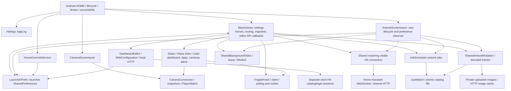

# Current architecture and capability inventory

Historical audit baseline: `a006420`. For subsequent approved source changes, the debug installation and remaining verification gates, see [implementation status](IMPLEMENTATION_STATUS.md).

Baseline and evidence limits are in [01](01_EXECUTIVE_SUMMARY.md). Kotlin paths below are relative to `app/src/main/java/com/evofactory/hal/`. Source line anchors in [06](06_CODE_REVIEW.md) refer to the baseline commit. This matrix records responsibilities, not a proposed directory reorganization.

## Stack and entry points

One Gradle application module, Kotlin with Compose compiler plugin 2.4.21, AGP 9.5.0, Java 25 Gradle toolchain, compile SDK 37, target SDK 36 and min SDK 28. Compose BOM 2026.09.00 resolves runtime 1.12.1; TV Material provides TV controls. Media3 1.11.1 handles RTSP, clips and file video. OkHttp 5.5.1 handles HTTP/WebSocket, NanoHTTPD 2.3.1 the bundled editor, ZXing 3.5.3 QR codes, and Conscrypt 2.8.0 TLS 1.3 on Android 9. There is no Room database, DI container, WebView TV renderer or WorkManager application layer.

`HalApp.onCreate` starts logging. Exported `MainActivity` is `singleTask` and accepts HOME and LEANBACK launcher intents. `onNewIntent` handles explicit Home focus and editor activation. `HomeOverrideService` is an optional accessibility service, protected by Android's binding permission and explicit user enablement. `ArtworkScreensaver` and `CameraScreensaver` are separately selected DreamServices. `ArtworkRefreshJob` is protected by `BIND_JOB_SERVICE`.

The generated debug merged manifest also contains AndroidX Startup's non-exported initialization provider with EmojiCompat, ProcessLifecycle, OkHttp platform and ProfileInstaller initializers; ProfileInstaller's exported receiver requires `DUMP`. Inspect the release merged manifest before making release initializer claims. No app-owned boot receiver was found despite the declared boot permission.

## Capability-to-implementation matrix

Frequency codes: **P** once/lazy per process; **C** composition lifetime; **V** visible lifecycle; **E** data/event change; **U** explicit user operation. Cached preferences are in-memory Android SharedPreferences after initial load; repeated getters are not necessarily repeated disk reads.

| Capability / purpose | Implementations and consumers | Ownership, initialization, lifecycle, frequency | Data, dependencies, cache / resource cost | Consolidation assessment |
| --- | --- | --- | --- | --- |
| App discovery and metadata | `InstalledApps.loadInstalledApps`; `MainActivity` supplies Apps card, drawer and editor | Activity list seeded synchronously from prefs; full two-category query after a frame on each resume, V | PackageManager labels, components; JSON list persisted; Binder and sorting work | One discovery function already; missing event/version invalidation, HAL-03 |
| App launching / app info / uninstall | `InstalledApps` extensions; `AppRow`, `DashboardAppsCard`, web TV actions | U; Android owns target app and uninstall confirmation | Explicit component intents; runtime failures show toast; app-info/uninstall PM checks on action | Keep one launcher path; do not merge with HA actions |
| App tile pictures | `InstalledApps.loadTileImage`, `AppRow.AppTile`; Apps and drawer | P count-LRU, individual C producers on IO | 100 package-keyed 320x180 banners / 160x160 icons; cache hits reused, misses not coalesced | Share version invalidation and requests, HAL-03 |
| Watch Next provider | `WatchNext.readWatchNext`; Activity resume/observer; dream observer/effect | Independent V owners and refresh state; Activity reads even with slideshow off/local | Full provider query, local filtering, metadata lists; no shared query cache | Share demand-driven snapshots, HAL-03; retain filtering contract |
| Configuration storage / migration | `LauncherPrefs`, `DashboardLayout`, `VideoBackgroundSettings`, `ExportImport`; Activity, editor, both dreams, helper | Durable prefs authoritative; Activity mirrors, dream broad revision observer, browser drafts independent; C/E/U | JSON decoding, old dock/Assistant/schema migration; async `apply` | Section-level typed observation, HAL-05/11; no mandatory storage-library migration |
| Layout / template import | `DashboardLayout`, `HaDashboard`, `CardVisibility`; browser `editor.js` | Saved independent Home layout; templates acquired on demand/legacy startup | Up to 64 views; explicit grid positions; legacy Assistant decode preserved | Keep model/parser separate from UI; remove only obsolete active orchestration after parity |
| Entity states / commands | `HomeAssistant` protocol; `HaConnection` in `HomeAssistantPanel`; `HaConnectionRuntime` | Process holder for matching subscription configuration; main-thread mutable entity map; leases V, 750 ms teardown | Server states authoritative; registry aliases; reconnect snapshot reconciliation; 5 s reconnect | Good existing sharing; no claim of always one socket across different configs |
| Editor HA catalog / authentication | `DashboardEditor` catalog effect; `WebConfiguration` / HA login helpers | Enabled editor visible session, catalog once per server/refresh; U login verification | Full states/registries/templates; short separate socket, 25 s catalog bound | Distinct purpose from filtered live states; share metadata only if freshness/parity established |
| HA state presentation / actions | `HaStateCue`, `HaPrimaryAction`, `HaLightColor`, `HomeAssistantPanel`, `HomeAssistantTab` | Pure derived decisions; commands U using latest state | Capability checks, RGB, select/scenes/buttons, names | Preserve common policy; renderers may differ |
| Visibility and focus eligibility | `CardVisibility`, `DashboardLayout`, TV projections and browser rule authoring | E from referenced HA states; rules belong to card/item | Nested exact-state rules, imported missing-state semantics; hidden/reserved rows | Shared model already; projections must preserve all inputs |
| Weather / forecasts | `HomeAssistantWeather`, `CalmOverview`, `ArtworkScreensaverContent`; `followForecast` | Current weather discovered per HA connection; hourly/daily follow for all weather IDs regardless UI mode | HA forecast maps retained; minute display filtering per mounted forecast | Demand union HAL-06; separate surface choices intentional |
| History / gauges | `HaHistory.HistoryGraph`, `HaGauge` | Graph V coroutine every 5 min; live state collector; minute window tick; gauge E | HA history responses plus live samples; per-graph series, memoized transforms | Optional exact-request coalescing only if repeated graphs measured; keep distinct time windows |
| Player metadata and progress | `HaMediaPlayer`, `CalmMediaRow`, screensaver player bubbles | Shared model and monotonic playback anchor; per-visible reading 250 ms progress updates | HA attributes; progress read in draw phase, integer-second label | Good reuse; no new universal clock unless profiling warrants |
| Player artwork | `HaMediaPlayer.MediaArtwork`, `HaSession.mediaArtwork`; all player renderers | C image producer keyed by art/size/session; IO fetch, Default decode | <=4 MiB response, bucketed decode/1536 edge bound; no shared decoded/request cache | HAL-04, share within this trust domain |
| Slideshow catalog | `ArtworkCatalog`, `JustWatchReleases`, `ArtworkRefreshJob` | JobScheduler daily and immediate jobs only while launcher/dream visible; process mutex | 20 titles; batches of four HTTP tasks; atomic metadata file; freshness checks | Already coordinated; preserve visibility and settings checks |
| Local slideshow files | `LocalArtwork`; editor upload/list/delete and rotation | U mutations, E change flow, synchronized directory access | 20 images, 8 MiB each, dimensions <=8192; generated IDs and no-follow filesystem checks | Correct dedicated trust boundary; do not replace with generic file API |
| Slideshow decode / fade | `DashboardArtwork`, `SharedArtworkRotation` | One winning V runner; ~45 s rotation / 1.2 s fade; P retained frame/queue | RGB565 sampled <=1920x1080; two decoded fade frames plus prefetched next; 32 MiB HTTP cache | Already shared; retain handoff, measure retained bytes |
| Background video | `VideoBackground`, `VideoBackgroundSettings` | Process controller/application context; token ownership; V RESUMED, paused 750 ms lease | One muted Media3 player, ~8 MiB target buffer, eligible playlist union; watchdog/retry/switch timers | Keep shared controller; per-item watchdog gap HAL-10 |
| Camera live playback | `CameraView.CameraConnection`, `Cameras`, `Screensaver.CameraRotation` | Per-needed stream, LifecycleStartEffect; release hidden; SurfaceView reparented for fullscreen | RTSP/SDP rewrite, codec/decoder limits, bounded reconnect/status/snapshot callbacks | Distinct from file video; retain specialized policy |
| Camera protocol diagnostics | `CameraTest`, `StreamDescription`; explicit web Run on TV | U dialog and IO probes, MediaCodec diagnostics | RTSP control/auth/RTP/AAC inspection, structured report | Test protocol versus playback intentionally differs; shared SDP primitives already |
| Camera snapshot storage | `CameraView.latestSnapshots`, `SnapshotStore`, `loadSnapshot`, pruning | P memory map; per-stream capture at 10/60 s; save/prune raw threads | 960 px snapshots, JPEG files keyed by 32-bit URL hash; no atomic save/coalescing | HAL-01; retain last-good frame but contain IO and ownership |
| Decoder tracking | `StuckPlayers.PlayerWatch`, `awaitPlayersGone`; cameras, clips, video | Per-player 2 s ping until playback thread ends; 50 ms bounded waiting | Process watched/stuck lists; release on player thread via Media3 API | Deliberate hardware workaround; benchmark release stalls before redesign |
| Frigate feed / availability | `Frigate`, `FrigateAlerts.rememberFrigateFeed` | One feed per configured Activity composition; V query 30 s / failed reachability 5 s; event-triggered refresh gap 1 s; socket retry 5–300 s | Client token and cert pin; cached recording existence; sequential video probes; bounded alert list | Poll reconciles missed socket events; not automatically redundant |
| Frigate thumbnails | `FrigateClient.thumbnail`; alert rows/grid | Client count-LRU; C/V load | Full decodeStream; no image byte/dimension budget or in-flight dedupe | HAL-09; isolated authenticated loader policy |
| Frigate clip playback | `FrigateAlerts` Media3 player | U selection; pauses hidden, prepared player retained | Shares authenticated HTTP with feed; progress timer 200 ms V | Retention intentional for quick return; do not merge with background player |
| Remote input and focus | Helper, Activity dispatch, preview handlers, `RemoteButtons`, grid/Apps/popup focus | Android key dispatch then surface-specific consumers; focused target C state | Home wake consumption, collapse wake/repeats, color/camera shortcuts, two-stage card entry | Shared decisions useful; one global focus graph would lose intentional behavior |
| Scroll / layout | `HomeAssistantTab`, `DashboardAppsCard`, `AppRow`, `TopDialog`; browser pointer grid | Screen/view C; explicit keys/requesters, scroll-into-view | Eager positioned dashboard versus lazy app drawer; popup reflow; browser rendered-track gestures | Measure eager large grids; keep saved positions and control semantics |
| Themes / visual transforms | `Theme`, `UiColorCycle`, widget paints | Theme from saved choice; optional 500 ms color cycle while active | Material palettes, opacity locals, graphics-layer filter, protected artwork/RGB | Shared styling exists; measure layer cost before altering visuals |
| Clock / forecast display timing | `HomeTopBar`, `ArtworkScreensaverContent`, weather forecast rows | Minute clocks per visible host; screensaver motion one frame clock | Wall time for labels; monotonic time for motion/playback | Separate cheap clocks justified by lifecycle |
| Screensaver bubble motion | `ScreensaverBubbles`, `ArtworkScreensaverContent` | Dream presentation; one frame loop and persistent trajectory IDs | Layer translations; collision pairs O(n²), capped iterative solver; 32 absent bodies warm | Specialized tested capability; stress high media count before optimizing |
| Editor serving / settings drafts | `DashboardEditor`, `WebConfiguration`, browser HTML/CSS/JS | Launcher session toggle; debounced visibility including dream; socket teardown IO | HTTP workers call main API; revision, export/import, validation; client draft copies | Browser draft is intentional; main transforms HAL-07 |
| Network / device diagnostics | `NetworkStatus`, `PingDialog`, `LauncherUtilities` | Main callback V; status dialog polling, ADB probe IO, explicit ping process | Capabilities/link properties correlated; settings/NSD observation; no permanent probe daemon | Shared connectivity callback could help if duplicated costs measured; no urgent manager |
| Dialogs / text fields / menus | `TopDialog`, `ContextMenu`, `TvTextField`, `SettingsButton` | C focus/input state; menu consumes long-press release | Local popup anchors and focus rows | Preserve reusable UI primitives and deliberate dismissal behavior |
| Icon font | `HaIcons` | P map with mutex-serialized IO loading; per-icon state producer | MDI font and name-to-codepoint asset | Already shared; per-item producer overhead unmeasured |
| Logs / crash reporting | `AppLog`, `HalApp`, editor download | P daemon single writer; hourly retention 1–72 h, 2 MiB chunk bound | External app files with private fallback, platform logcat, uncaught handler waits <=1 s | Different redaction between sinks, HAL-13 |

## State and resource boundaries

Persisted user choices live in `launcher.xml`; credentials share that file with layout and appearance. Screensaver last-view and last-image markers also live there. Catalog JSON and uploaded images live in private files; HTTP images in cache; camera snapshots in private files; retained logs in app external files with private fallback. No application SQL storage was found.

Live HA states belong to the connection, not preferences. Browser drafts intentionally differ from saved state until Apply/Save. MainActivity and the dream independently materialize configuration; broad dream invalidation makes that duplication expensive (HAL-05), but their independent lifecycle is necessary for a cold dream. Fullscreen camera uses the same stream/view rather than another player. Background video uses application context; app tile cache stores bitmaps rather than Activities. The static Apps wake-key callback is installed/removed by composition effects; recreation and late-disposal parity still require instrumentation.

Failure isolation is generally feature-specific: missing images use placeholders/black, rejected integrations show errors, launching apps catches runtime failures. Camera preference parsing and snapshot worker failures are exceptions. A native-memory snapshot cannot establish retained Activity leakage; the observed four Activity objects require allocation/lifecycle evidence before calling them leaks.

## Architectural archaeology

`7a852bf` renamed HomeBoard to HAL. `449e324` added appearance/App collapse and scalable media panels. `9c5402b` introduced Calm and retired Assistant. `c9d10c0` added configurable bubbles and video. `37e3d5e` introduced global Android dreaming and shared visible HA/slideshow/video ownership while deleting `HalIdleInput`, `HalIdleState`, `HalIdleTimeout` and `HalScreenAwake`. `9f88be1` expanded forecast/media/presentation reuse. `d7971e9` moved configuration to the web UI. `7d6846d` added popup column settings.

This history supports incremental consolidation, not a claim that the old foreground screensaver still runs alongside the new dream. Remaining Assistant-named types/comments and old preference keys often serve import/migration. Confirm consumers before deletion. `tmdb_logo.xml` and the boot permission are small cleanup candidates with no established runtime cost; HAL-14 keeps them lower priority.
