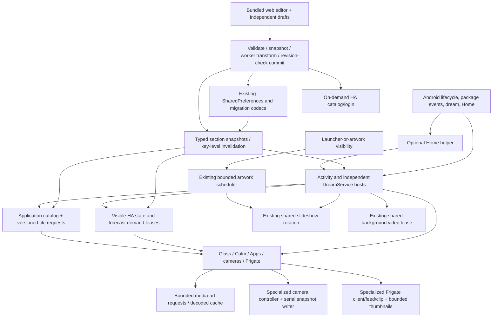

# Proposed target architecture

This target derives from [02](02_CURRENT_ARCHITECTURE.md), [03](03_DUPLICATION_AND_CONSOLIDATION.md) and [06](06_CODE_REVIEW.md). The user approved the implementation roadmap on 2026-11-25; it is partially implemented on `codex/architecture-consolidation`. [Implementation status](IMPLEMENTATION_STATUS.md) distinguishes completed source work from conditional experiments and outstanding device checks. Preserve existing features and persisted formats; approval of consolidation does not authorize the separately gated product or lifecycle changes.

## Shape and ownership

Keep one application module. Use a few clearly scoped shared capabilities with small immutable outputs; keep presentation and focus owned by each screen. Do not add DI, a database, navigation framework or a universal manager merely to make the diagram look layered.

The dependency direction is hosts/presentation → capabilities → platform/transport/storage. Capabilities do not depend on MainActivity, focus requesters or browser forms. Protocol and layout codecs remain usable in JVM tests. Sharing occurs through snapshots and leases, not arbitrary access to a mutable global object.

| Concern | Authoritative state | Derived state / consumers | Resource and lifecycle owner |
| --- | --- | --- | --- |
| Installed applications | PackageManager; cached last-known snapshot accelerates startup | Ordered/hidden Apps selection, all-apps drawer, editor choices | Application-context catalog; event invalidation, bounded reconciliation, version-keyed image cache |
| User configuration | Existing saved preference keys/schema | Separate typed layout, integration, appearance, artwork, video and utility snapshots; browser draft remains independent | Storage adapter owns decoding/section transaction; hosts observe relevant sections |
| HA entities | Live HA server session | Display cues, visibility, media, current weather, graph samples | Existing visible connection host; canonical subscription config and active demand leases |
| Forecast demand | Active consumers plus their saved surface modes | Union of hourly/daily requests by weather entity | HA runtime; changes update forecast requests without unnecessarily reconnecting entities |
| Player images | URL content within configured origin/account generation | Size/transform-specific decoded image | Dedicated bounded request/cache owner; cancelling one consumer does not cancel other waiters |
| Slideshow | Saved source settings, catalog/local files and eligible Watch Next snapshot | Rotation order, caption and frames | Existing shared rotation, one runner; host visibility controls work |
| Background video | Eligible deduplicated playlist | Current item/readiness/position | Existing token-leased controller with per-item readiness state |
| Camera snapshot | Latest good capture per stable stream identity | Retained bitmap, atomically persisted JPEG | Camera display state plus bounded serial writer; failure cannot terminate host |
| Frigate | Server review/recording state | Cached alert/video existence and thumbnails | Feature client/feed and prepared clip player; visible work, explicit trust policy |
| Input/focus | Current Android key sequence and mounted focus graph | Selected card/tile, popup, Home request token | Host/surface; pure shared routing decisions, no process-global focus tree |

## Initialization and background boundaries

On cold launch, load only the validated settings snapshot and cached app labels/components needed to draw a navigable launcher. Do not wait for HA, cameras, artwork, editor metadata or recommendation services before app launch is possible. First-run cache miss starts one app query promptly and displays usable results as soon as ready; do not hide this behind a successful blank-frame metric.

Optional refresh work remains after a retained frame, as required by the existing handoff, and should be staggered based on demand rather than released as one uncontrolled deferred burst. Add timestamps for first focusable content and first successful app launch. MainActivity and a cold dream each acquire their own resource leases. No Activity reference flows into process-owned capabilities. Keep the established 750 ms HA/video grace periods. Changing that behavior requires explicit user approval supported by paired device measurements; measurements alone do not supersede the current contract.

When hidden, keep lightweight cached snapshots and dashboard focus, stop provider/network/UI producers without consumers, and release video/HA after their bounded lease. Do not clear every image at `onStop`, force a permanent foreground service, keep windows awake or change Android screensaver settings. Memory-pressure eviction should release reproducible images/caches first; do not evict persisted user choices or destroy the only retained last-good frame prematurely.

The existing hidden-HAL contract specifically retains cached app icons/HA values, decoded slideshow frames/fade/queue and the prepared paused Frigate clip. Ordinary visibility changes must not evict those resources. Cache budgets should preserve that retained working set; a system memory-pressure policy is a separate measured decision, not permission to clear caches on hide. The dream must remain independently cold-startable, while its editor exception applies only to an already enabled launcher-owned session. Shared Watch Next demand must not create an always-on observer, and shared media images must not add a video decoder, live HA subscription or per-bubble timer.

## Caching and invalidation

- App snapshot: seed from saved metadata; package add/remove/change invalidates affected package and tile generation; reconcile after periods where events were not observed. Avoid promising perfect incremental event coverage.
- App pictures: key by package/component/version generation and requested bounds; bounded bytes; deduplicate cache misses. Keep aspect-ratio fitting and focus clearance.
- Media art: key by resolved URL, account/origin generation, decode bucket and transform. Never log raw token-bearing keys. Retain entries across session reconnect only when account/security identity matches. Explicit logout drops protected cache entries.
- Frigate thumbnails: bounded compressed response and pixels, sampled to actual display target, byte-weighted LRU and coalesced misses. Keep its certificate/authentication policy separate.
- Settings: compare relevant raw strings/keys before decoding; batch a section's writes, emit immutable changed values. Cache parsing results, not unsafely shared mutable JSON.
- HA/graphs: retain current state semantics and snapshot reconciliation. Consider sharing exact history requests only after traces show repeated equivalent graph windows; do not generalize all historical data prematurely.
- Catalog/slideshow: retain existing atomic metadata write, bounded playlist, shuffled queue, two-frame fade and HTTP cache. Measure next-image prefetch and hidden retention as a whole.

## Error handling and failure isolation

Every shared capability returns the last good snapshot plus a recoverable status when possible. Optional storage/image/network failures cannot terminate app launching. Catch expected IO/format errors at the owning boundary; propagate coroutine cancellation. Reject unsafe or inconsistent configuration without discarding the user's draft. Corrupt saved settings should be retained for repair, with a minimal launcher fallback, rather than overwritten as an empty valid configuration.

Use bounded queues and deliberate overload handling. HA protocol messages contain command replies and state deltas; indiscriminate conflation/dropping is unsafe. A queue limit should reconnect and reconcile a new snapshot on overflow, while trace counters identify the producer rate and main-thread backlog.

## Current-to-target mapping

| Existing component | Action | Reason / finding |
| --- | --- | --- |
| `MainActivity` | Refactor orchestration into small configuration/catalog adapters, keep lifecycle and routing | HAL-03/05/11; decrease coupling without changing UI |
| `LauncherPrefs` and schema codecs | Reuse storage/migrations, extend with section observation and safe recovery | HAL-02/05/11; no DataStore rewrite required |
| `InstalledApps`, Activity/dream Watch Next effects | Consolidate producer ownership; reuse pure query/filter functions | HAL-03 |
| `HaConnectionRuntime` | Reuse leases, add forecast-demand policy and observable queue/error behavior | HAL-06/08 |
| `HaMediaPlayer.MediaArtwork` | Replace local fetch ownership with thin shared-image consumer | HAL-04; retain metadata/progress/UI |
| `DashboardEditor` / `WebConfiguration` | Keep API boundary; snapshot and offload large pure transformations | HAL-07 |
| Snapshot worker threads | Replace with bounded serial atomic writer, remove old raw workers | HAL-01 |
| `FrigateClient.thumbnail` | Refactor decoding/cache policy locally | HAL-09 |
| `BackgroundVideoController` | Correct item readiness/watchdog state, retain lease/controller | HAL-10 |
| `SharedArtworkRotation`, visibility helpers, primary actions, layout model, themes | Retain | Existing useful shared capabilities |
| `HomeAssistantTab` / Calm / Apps / popups | Keep distinct presentations; extract only pure repeated projections verified equivalent | Avoid feature/focus regressions |
| Legacy Assistant/dock import readers | Retain compatibility; simplify obsolete runtime branches only with migration coverage | Saved user data contract |

## Benefits, trade-offs and rejected alternatives

Expected startup and Home-return gains come from avoiding repeated work and making configuration decoding explicit. Shared request ownership should reduce media-image allocations/network transfer; section observation should reduce unrelated dream recomposition. None of these benefits has a measured percentage yet. Reliability improves by containing failures before they cross feature boundaries; maintainability improves because a new feature can find a documented owner.

A full MVVM/Clean Architecture rewrite would create broad migration risk without measured benefit. One global state flow would widen invalidation. One universal HTTP/image manager would mix trust domains. Replacing Compose with Views would discard existing tested behavior without evidence that Compose is the bottleneck. Removing transparency, media bubbles or color cycling before measuring them would violate visual requirements. Keeping two old/new catalog systems indefinitely would defeat the consolidation objective. Use the phased removal gates in [07](07_IMPLEMENTATION_ROADMAP.md).
