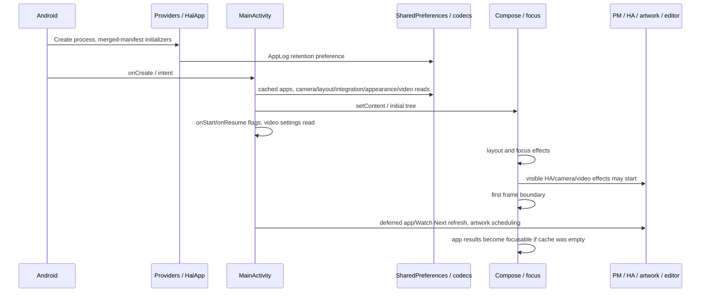

# Performance audit and measurement plan

Historical audit baseline: `a006420`. For subsequent approved source changes, the debug installation and remaining verification gates, see [implementation status](IMPLEMENTATION_STATUS.md).

This document separates measured observations from source-based opportunities. No application source, APK, system settings, current app or screensaver selection was changed to obtain the observations.

## Evidence collected

On 2026-11-25, explicit ADB serial `10.1.0.130:5555` identified the office device as product/device `darcy`, model `SHIELD_Android_TV`, SDK 30. Fingerprint: `NVIDIA/darcy/darcy:11/RQ1A.210105.003/13961458_4387.0822:user/release-keys`. Both office and living-room devices were connected; no measurements were taken from the living-room serial.

| Observation | Result | Interpretation limit |
| --- | --- | --- |
| Installed HAL | 1.2.0/code 17, target SDK 36; DEBUGGABLE; lastUpdateTime 2026-11-24 23:17:36 as reported by device | Exact installed source revision/signature not established; unsuitable for release speed claims |
| Current host | HAL DreamActivity resumed, MainActivity root visibility 8, dream root visibility 0 | Memory and historical counters are not isolated dashboard/input measurements |
| Historical frames | 269,400 rendered, 666 janky (0.25%); missed-vsync 53; deadline-missed 387 | Unreset historical session; unknown scenario mix, compilation/thermal state and duration |
| CPU-frame percentiles | p50 5 ms, p90 6 ms, p95 7 ms, p99 12 ms | `gfxinfo` frame distribution; not end-to-end remote input latency |
| GPU percentiles | p50 2 ms, p90 4 ms, p95 14 ms, p99 15 ms | Historical bins include extreme 4950 ms bucket; trace needed before assigning cause |
| Total proportional memory | 354,659 KiB (~346.3 MiB) | One snapshot; includes native/graphics/process state; not a leak or peak measurement |
| Memory breakdown | Native heap PSS 112,100 KiB; Dalvik heap PSS 37,311 KiB; EGL mtrack 103,936 KiB; RSS total 442,396 KiB | PSS/RSS, heap allocation and graphics caches are different measures; do not add overlapping summaries |
| Object counts | 4 Activity objects; 2 ViewRootImpl in attached hierarchy | Not evidence of four leaked screens; heap retention paths/repeated lifecycle samples required |
| Render backend / layer | Skia OpenGL; reported layer 1920x1080 | Does not establish HDMI mode, panel model or genuine 4K UI performance |

The historical frame data contains slow outliers as well as many quick frames. Neither the low aggregate jank percentage nor the extreme bins identify the user-visible behavior causing them. No controlled cold/warm/hot startup, Home-return, input latency, hidden CPU/network baseline, allocation profile or decoder-load comparison was collected. This was a non-disruptive inspection while the dream remained active.

Reproduce read-only observations with the project ADB binary and explicit office serial:

```powershell
$halAdb = 'C:\Projects\HAL\build\hal-toolchain\android-sdk\platform-tools\adb.exe'
& $halAdb devices -l
& $halAdb -s 10.1.0.130:5555 shell getprop ro.build.version.sdk
& $halAdb -s 10.1.0.130:5555 shell getprop ro.build.fingerprint
& $halAdb -s 10.1.0.130:5555 shell dumpsys meminfo com.evofactory.hal
& $halAdb -s 10.1.0.130:5555 shell dumpsys gfxinfo com.evofactory.hal
```

Do not commit raw logs, traces, dashboard exports, credential-bearing URLs or full device dumps. Store future raw profiling artifacts privately; document sanitized results and test configuration.

## Startup critical path



`withFrameNanos` establishes a frame-clock boundary, not proof that the GPU presented an interactive frame. Do not call it a complete startup benchmark. `MainActivity.onCreate` performs synchronous settings decoding before `setContent`; AppLog accesses preferences earlier in process creation. Optional networking is not awaited to enable app launching, but HA/camera/video initialization and decode work can contend with initial interaction. First-frame deferred work can itself become a burst immediately after startup.

| Work | Current timing | Appropriate boundary / assessment |
| --- | --- | --- |
| Intent/Home/editor-session routing | onCreate/onNewIntent | Essential before routing/focus; retain |
| Minimal theme/layout/app selection | Synchronous prefs reads before compose | Enough is needed before correct first content; trace HAL-11 before deferring |
| Installed-app cache decode | Main before compose | Enables immediate usable app list; keep bounded and validate |
| Initial app query on empty cache | After resume frame, IO | Essential before first app launch on fresh setup; start promptly and measure actual readiness |
| Full app reconciliation on unchanged return | Every resume, IO | Redundant when freshness established, HAL-03 |
| Watch Next | Resume and observer; dream media-art demand | Optional and should require media-art consumers, HAL-03 |
| HA current states | Visible connection | Optional to launcher readiness; live controls depend on it |
| Forecast subscriptions | Both types/all weather on connection | Demand-gate HAL-06; never count as basic launcher startup prerequisite |
| Icon/banner loads | Per tile on IO | Placeholders may appear while controls remain usable; deduplicate misses |
| Artwork decode/catalog/video | Visible effects/jobs | Optional; bound contention and preserve black/image fallback |
| Editor bind/catalog | Session enabled, delayed/debounced | Feature-specific; should not gate normal focus/app launching |
| Home-helper confirmStarted | 2 s runnable | Crash-guard bookkeeping, not an artificial screen delay; retain until guard coverage |

### Startup cases requiring separate measurements

| Case | State / expected behavior | Required evidence |
| --- | --- | --- |
| Cold process | No process, saved config/cache present | launch request → TTID → first valid focus → successful selected app launch |
| Warm Activity | Process/cache retained but Activity recreated | lifecycle recreation and state reconstruction; distinct from retained resume |
| Hot return | Existing Activity/composition retained | Home key → selected focus presented; no unnecessary full discovery |
| First install | No user config or app cache | Time until apps can actually launch, permission prompt influence; no fake ready marker |
| After update | Existing prefs, possibly changed package/components | Cache invalidation/migration and ART compilation effects |
| After reboot | System services/provider/package data warming | First Home and helper activation; do not infer from normal cold process |
| Sleep/wake | Android power/dream/CEC transitions | External timing/video + focus path; do not substitute app `am start` |
| Process death | Saved configuration intact, remembered state gone | deterministic fallback view/focus, credentials/layout preserved |
| Offline | Optional services absent/slow | app launch remains available; no retry burst blocks interaction |

## Input-to-presentation path

Home may first reach `HomeOverrideService.onKeyEvent`, which checks dream wake and collapsed Apps consumption, then brings the single Activity forward on release. Activity dispatch offers Apps' active wake-key handler first. Compose preview handlers route available color tabs/camera shortcuts; grid/card/Apps/popup focus policies choose the next target. Focus state changes update borders/selected content and scroll off-screen targets into view. Android/Compose then measure/draw and the compositor presents the result. Ordinary OK on a focused app calls the explicit component launcher; entity controls select a service from the latest HA state and call asynchronously.

A key legitimately consumed to wake a collapsed Apps card or dismiss the dream is different from lost input. Timers for long-press/repeat-release handling, 750 ms resource leases and frame waits have specific contracts. Do not remove them as “arbitrary delay” without input-sequence regression tests. The two-frame Home-focus handoff in `HomeAssistantTab` is a measurement target, not a proven focus defect.

Potential competing main work: editor model transforms HAL-07; configuration projection HAL-05/11; HA queue dispatch HAL-08; Media3 player create/release; eager visible-page grid projections; graph drawing/path construction. None has measured input attribution yet.

## Rendering, memory and hidden-work assessment

**Retain:** progress clock reads during drawing, integer-second elapsed labels, motion translations in layers, a single bubble frame clock, shared MDI map mutex, memoized projections and shared slideshow decode. These are actual optimizations present in code. Do not propose them as missing.

**Measure:** eager positioned card grid composes all visible-rule cards in the selected view, including those outside the scrolled viewport; large app-card rows can instantiate many tiles; high media bubble counts increase pairwise collision checks; graph draws build paths from full series; optional color cycling uses layer filters and some paint-state composition reads; translucent fills/gradients and TextureView can increase GPU bandwidth. These are hypotheses to trace before recommending virtualization, downsampling, a different surface or visual changes. No universal conclusion about GPU bottleneck follows from a single counter snapshot. At 60 Hz the display interval is ~16.67 ms; at other rates derive the actual interval rather than assuming 60.

**Memory ownership:** app pictures are shared count-LRU; media images local to each reading; Frigate thumbnails count-LRU; slideshow retains current/incoming plus a prefetched next result; camera snapshots retained per URL; file video and prepared clips hold native decoder/buffer resources. A 1920x1080 RGB565 frame is about 4 MiB before texture/other overhead. One hundred 320x180 ARGB app banners are approximately 22 MiB of pixel storage, not a measured cache occupancy. Account native/graphics alongside managed heap. No `onTrimMemory` cache policy was found; add only with measured budgets and warm-return trade-offs.

**Background:** most recurring producers use visibility helpers or lifecycle blocks. HA disconnect and background video release have 750 ms grace. Artwork jobs cancel when both hosts hide. Frigate feed polling/socket stop hidden; prepared clip pauses but may retain bounded buffers. PlayerWatch intentionally polls unfinished playback threads; Home accessibility must remain responsive. Cheap preference/settings observers can remain; a blanket “zero background work” target would conflict with requirements. Dream-visible work is foreground functionality even if Activity is stopped.

## Reproducible controlled benchmark campaign — proposed, not run

1. Use the office serial explicitly; record model/API/firmware, app source commit and signing/build variant, thermal/uptime state, compilation mode, display mode/density and network/service fixture. Do not change output mode or stop another app during ordinary use without arranging a test session. Confirm the LG model only if panel-specific checks are needed.
2. Use an authorized release-equivalent profileable/minified APK with the existing signing key. Preserve the user configuration; use a dedicated synthetic fixture or safely reversible test setup. Never clear HAL data to simulate cold start. Restart the process only in the planned campaign; reboot/first-install tests belong on an agreed test fixture/device.
3. Record at least 20 cold and 30 hot-return iterations, with warm-up defined and raw distributions retained. Separate compilation modes and populated/empty image caches. Record median/p90/p95 and outliers. Do not compare first-ever debug execution to compiled release.
4. For each run measure TTID, a correctly defined usable-app/focus ready marker, key dispatch → focus selection → presented frame, and first successful app launch. Add trace sections such as `HAL.config.decode`, `HAL.apps.query`, `HAL.focus.home`, `HAL.editor.validate`, `HAL.image.decode` and queue/request counters. Their names are proposals, not existing instrumentation.
5. Use Macrobenchmark startup metrics where compatible, Perfetto scheduling/Binder/IO/graphics traces and device-supported frame data. On API 30, do not require Android-12-only TTFD/frame-overrun metrics. Add timestamp/trace-ready markers and CPU-frame/gfxinfo analysis; use external high-frame-rate video to confirm physical remote/display latency. Verify the installed benchmark library's actual SDK support before choosing metrics.
6. Before a navigation journey, reset **only graphics counters**, then perform a fixed 60-second directional sequence (single, repeat, rapid reversal), dialogs, Apps launch/return and scrolling to off-screen cards. Collect frame data and trace; annotate keys intentionally consumed for dream/Apps wake. Counters must be isolated per scenario.
7. Repeat fixtures: basic apps only; populated HA/cards/visibility/graphs; Glass/Glass Dark/Calm; slideshow fade; file video; camera grid/fullscreen; Frigate clip/feed; global dream handoff and cold dream. Exercise multiple consumers of shared images simultaneously.
8. Sample meminfo/native/graphics and CPU/network at steady visible state, 1/10/30 minutes hidden, return, and after 100 surface changes. Capture heap retention paths privately only if growth persists. Test other memory-heavy app residency without artificially pinning HAL.
9. Inject offline/slow HA, failed artwork, malformed saved optional section, low-storage snapshot failures, app package update/removal and stalled second video. Fault injection must use test seams or a controlled fixture, not filling or corrupting the user's TV.
10. Compare matched before/after runs. Keep or revert based on actual benefit and behavioral parity; do not trade responsiveness for lower counters by rendering placeholders or hiding features.

### Proposed performance acceptance goals

The user's requested aspirational targets are: cold first visible frame under 500 ms, warm startup under 200 ms, hot startup under 150 ms, cold meaningful interaction under 1 second, remote visible feedback ideally under 50 ms, zero frozen frames/ANRs/normal-use crashes/unintended long-term growth, and near-zero missed deadlines/avoidable duplicate work. They are engineering goals subject to hardware validation, not claims about HAL today. TTID must be reported separately from usable focus and app launch.

The following tail-percentile gates are proposed operational definitions to calibrate with the owner after the baseline; they do not replace those requested targets:

- Hot Home return to usable correct focus: aim p95 <150 ms; warm startup p95 <200 ms; directional key-to-focus presentation p95 <=50 ms, p99 <=100 ms under the agreed steady fixture.
- Cold usable launcher: aim p95 <=1 s on a populated cache, then revise with measured startup breakdown; no optional-service wait on app launch.
- At 60 Hz, target <1% missed deadlines in fixed normal-navigation journeys and investigate every >100 ms frame. Compare p95/p99 as well as percentage; video/camera hardware-specific journeys get separate budgets.
- No full PackageManager/provider refresh on repeated known-clean returns; no forecast requests without demand; one in-flight request per identical image key; no full-layout decode on last-image marker writes.
- After a matched 100-cycle journey and stabilization, no persistent unexplained PSS/native/graphics growth; set explicit cache byte budgets from device measurements rather than an invented universal RAM target.
- Hidden host release/cancellation follows the existing 750 ms contracts plus bounded shutdown, with no recurring catalog/HA/UI work after all consumers stop; exception is deliberate helper/watchdog behavior.

### Commands for a planned diagnostic session

These commands are examples for a dedicated future test session and were **not run** during this review. The force-stop interrupts HAL; it preserves saved data but must not be used casually while the TV is in use. No command clears preferences, changes the system launcher or writes power/display settings.

```powershell
# Cold process diagnostic; am -W is a display-time diagnostic, not proof of usable focus.
& $halAdb -s 10.1.0.130:5555 shell am force-stop com.evofactory.hal
& $halAdb -s 10.1.0.130:5555 shell am start -W -n com.evofactory.hal/.MainActivity -a android.intent.action.MAIN -c android.intent.category.HOME
# Reset only graphics counters before a fixed, recorded navigation journey.
& $halAdb -s 10.1.0.130:5555 shell dumpsys gfxinfo com.evofactory.hal reset
# Perform the same remote journey, then collect its frame and memory results.
& $halAdb -s 10.1.0.130:5555 shell dumpsys gfxinfo com.evofactory.hal framestats
& $halAdb -s 10.1.0.130:5555 shell dumpsys meminfo com.evofactory.hal
# Check tracing support before choosing a Perfetto config for this API/firmware.
& $halAdb -s 10.1.0.130:5555 shell perfetto --help
```

For a basic supported Perfetto CLI capture in that planned session, select a writable device trace location and available categories from its help output, for example `shell perfetto -o /data/local/tmp/hal-audit.perfetto-trace -t 15s sched freq idle am wm gfx view binder_driver`, then `pull` that exact file to a private local results directory. This writes a trace artifact, not a system setting. Capture alone is not analysis: correlate app trace sections, key events and frame presentation before assigning a bottleneck. FrameTimeline-specific availability must be checked on API 30.

## Verification performed

`--offline :app:testDebugUnitTest :app:dependencies --configuration releaseRuntimeClasspath` succeeded using the documented local JDK/SDK/Gradle: 144 tests, 26 suites, no failures/errors/skips. Unit compilation is not an APK build. JS syntax passed for editor/config/videos. `node tools/video-editor-check.cjs` passed video/configuration/mouse/touch checks at 1920/1280/420 px outside the sandbox; first sandbox execution timed out. No claim of HAL regression follows from that environmental timeout.

At the original audit checkpoint, offline `:app:lintDebug` could not resolve `com.android.tools.lint:lint-gradle:32.5.0`, absent from the cache. Lint had not produced a completed analysis, and no APK had been assembled or installed. Subsequent implementation fetched the dependency, passed debug lint and completed the requested debug build/install; see [implementation status](IMPLEMENTATION_STATUS.md). No controlled Perfetto, heap-dump, reset-counter journey or startup campaign is recorded.

## Authoritative references consulted

- [Android startup timing](https://developer.android.com/topic/performance/issues/launch-time): define readiness beyond first display; HAL needs app-launch/focus readiness instrumentation.
- [Macrobenchmark metrics](https://developer.android.com/topic/performance/benchmarking/macrobenchmark-metrics): distinguish CPU-frame duration and newer frame-overrun/full-display availability; verify API limits for the API-30 SHIELD.
- [Compose performance](https://developer.android.com/develop/ui/compose/performance/bestpractices): cache expensive unchanged transformations and defer frequent reads to later phases; HAL already applies this to progress/motion.
- [Baseline Profiles](https://developer.android.com/topic/performance/baselineprofiles/overview) and [measurement](https://developer.android.com/topic/performance/baselineprofiles/measure-baselineprofile): compare compilation modes on a physical device. No library-wide published percentage is a HAL forecast.
- [Resource optimization](https://developer.android.com/topic/performance/app-optimization/customize-which-resources-to-keep): AGP's current optimization DSL and legacy resource-shrink settings differ; verify the actual release output before cleanup.
- [NVIDIA SHIELD support](https://www.nvidia.com/en-us/shield/support/shield-tv/): display rate affects experience; record actual output rather than changing it to improve a benchmark.
- [Android backup behavior](https://developer.android.com/identity/data/autobackup): default eligible storage includes preferences/files; HAL's backup policy needs an explicit distribution decision.
