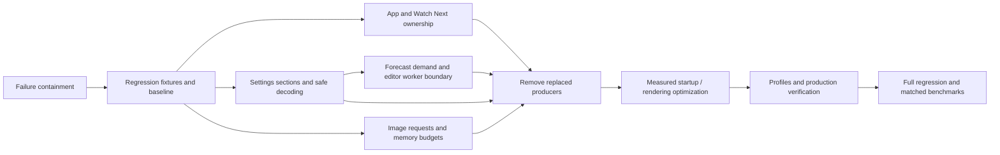

# Implementation roadmap

**Closed audit:** the scoped consolidation and recorded validation were delivered in `e016621`. This original planning matrix is retained for rationale and traceability. Unexercised acceptance scenarios and conditional experiments are separate follow-ups under [audit closure](AUDIT_CLOSURE.md); they are not an instruction to keep this audit running.

The user approved implementing this roadmap on 2026-11-25. The planning matrix below preserves the original scope; [implementation status](IMPLEMENTATION_STATUS.md) records completed source work, the requested debug installation and remaining gates. This roadmap preserves current user-facing behavior, visual quality and saved formats. Complexity is relative engineering effort, not a delivery-date promise. Keep changes reviewable and reversible with relevant handoff updates.

## Dependency order

Video watchdog and redaction corrections can proceed independently after targeted regression fixtures. Queue-overload changes require protocol evidence and should not be bundled into settings work.

## Tasks and acceptance gates

| Task / findings | Objective / affected features / expected benefit | Complexity / risk / dependencies | Acceptance and verification | Rollback |
| --- | --- | --- | --- | --- |
| R1 / HAL-01 | Contain snapshot IO first, then serialized atomic latest-wins persistence; camera home/grid/fullscreen/dream stay usable on failure | Medium; medium ordering risk; independent | Inject failed/slow writes and prune races; preserve previous good JPEG and newest timestamp; no uncaught optional IO; live SHIELD image parity | Revert writer adapter commit while retaining standalone exception containment; preserve existing snapshot format |
| R2 / HAL-02 | Recover invalid saved camera section without losing other settings; launcher/editor remain reachable | Low–medium; medium data-recovery risk; independent | Malformed/missing-field/legacy valid JSON fixtures; no silent overwrite; repair through editor; process-death relaunch | Revert recovery UI/adapter; retain raw saved bytes and fixtures |
| R3 / HAL-12 | Establish synthetic behavior fixtures and release-equivalent measurement harness for startup/Home/input/residency | Medium; low runtime risk; before infrastructure speed claims | Baseline campaign in 05, recorded commit/build/device/display/compilation; ready marker means launchable focused app; distributions and traces privately retained | Remove instrumentation/harness changes separately, keep results and procedures |
| R4 / HAL-13 | Sanitize both log sinks; preserve useful diagnosis | Low–medium; low behavior risk; independent | Synthetic URI/query/nested Throwable tests; zero secret values in logcat and downloadable log; bounded log behavior retained | Revert formatting separately; do not reintroduce unsafe call-site payloads |
| R5 / HAL-10 | Per-item first-frame watchdog independent from retained surface frame | Medium; medium playback/visual risk; event tests before change | Good→stalled second item advances in bounded time with interval 0; valid transitions/handoff/repeat/random starts preserve visuals; stale callback test and device decoding | Revert controller state commit; settings schema unaffected |
| A1 / HAL-03 | Shared application catalog and version-aware picture requests; migrate Apps/drawer/editor | Medium; medium package/focus risk; R3 | One query when dirty, no repeat query on clean returns; package install/update/remove/enable/disable while visible and hidden; stale launch failure safe; correct aspect ratios/focus | Revert consumer adapter; retain old persisted app-list format, no dual-writes |
| A2 / HAL-03 | Shared demand-controlled Watch Next snapshot, reuse provider/filter functions in Activity and dream | Medium; medium cold-dream/recommendation risk; A1/R3 | No query/observer while artwork off/local; one shared observer with overlapping consumers; fresh results after hidden changes; paid/program/service filters and ordering unchanged | Restore consumer refresh path in one commit; keep raw query and filter helpers |
| A3 / HAL-05/11 | Typed section observation over existing prefs, batched writes, cached codecs; migrate dream then Activity | Medium–high; high migration/revision risk; R2/R3 | Marker writes cause no layout/apps/video parse; relevant saves update each host; legacy defaults/schema/import/Restore/secret fixtures; independent cold dream; process death | Revert adapters per section; no on-disk schema change, old readers remain valid |
| A4 / HAL-04 | Shared media-art request/decode ownership within HA trust boundary | Medium; medium auth/cancellation/image risk; R3 | Duplicate readers share request/decode for identical key; account/logout/size/content revisions isolated; byte/concurrency bounds; no visual degradation | Revert `MediaArtwork` adapter; release cache safely without altering persisted state |
| A5 / HAL-09 | Bound Frigate image bytes/pixels/cache and coalesce requests | Medium; medium quality/auth risk; R3; A4 primitives optional | Oversized/corrupt images rejected before full allocation; small images sharp; authenticated clip/feed unaffected; repeated same request coalesces | Revert thumbnail path only; no Frigate config migration |
| A6 / HAL-06 | Forecast demand union by entity/type across visible consumers | Medium; medium weather/connection risk; A3 helpful | No forecast calls with zero demand; all modes/surfaces/fallback/reconnect tests; toggle does not rebuild unaffected HA state | Revert demand adapter; stored modes remain backward compatible |
| A7 / HAL-07 | Main snapshot → worker transform → revision-check commit for editor operations | Medium–high; high concurrency risk; A3/R3 | Main-thread trace excludes large pure transformations; concurrent edit/close/invalid/stale requests do not commit or falsely confirm; browser transfer and real pointer suite passes | Revert one endpoint adapter at a time; no protocol/schema change until proven |
| A8 / HAL-08 | Instrument queue backlog; add bounded protocol overload recovery only if evidence warrants | Medium; high delta/reply risk; R3, reconnect fixtures | Burst/slow-reader tests prove no silent delta loss; finite backlog, bounded retries, command completion/failure deterministic | Restore transport queue policy, keep counters; no state format changes |
| D1 / HAL-03/04/05/07/11 | Remove replaced active refresh/load/mirror paths after each migration, revise capability map | Low–medium; medium missed-consumer risk; corresponding A task | Search every caller; one authoritative producer per responsibility; no dual-refresh or dual-write; old imports continue loading | Revert removal commit immediately; do not keep permanent duplicate fallback |
| P1 / HAL-11/12 | Optimize measured startup critical path after consolidation | Medium; medium ready/focus risk; D1/R3 | Matched cold/warm/hot results improve or stay within budget; app launch/focus not deferred behind optional work; no post-frame work burst | Revert each measured optimization; keep instrumentation |
| P2 / HAL-12 and hypotheses in 05 | Optimize only traced input/rendering hotspots: large grid projections, graph path work, layers, decoder create/release | Variable; high visual/focus risk; D1/R3 | Same saved geometry/themes/visual assets and focus behavior; fixed rapid/repeated-key journeys and frame percentiles improve; no hidden control targets | Revert one optimization/experiment; avoid format migrations for rendering changes |
| P3 / HAL-04/09/12 | Set measured byte/concurrency/pressure budgets and hidden residency policy | Medium; medium warm-return risk; A4/A5/R3 | Native/graphics/managed memory stable across 100-cycle and hidden residency; no refetch storm or blank return; caches evict only reproducible data | Revert budget/policy change, retain cache correctness |
| B1 / HAL-14 | Decide backup exclusions/secret policy, inspect release shrinking/initializers/native packaging and profile benefits | Medium; medium distribution/update risk; R3; separately authorized APK build | Correctly signed minified update tested; API28/API30; backup/restore contract explicit; measured profiles A/B; dynamic assets intact; license/ABI/size inspection | Revert optimization/profile/policy independently; never uninstall user HAL to fix signing |
| V1 / all | Full feature regression and paired before/after benchmark campaign | Medium–high; low code risk; completed tasks above | All scenarios below pass, recorded limits, speed/memory improvements supported by matching data; owner visual/remote checks complete | Revert failing isolated task; keep diagnostic data |
| G1 / all | Adopt approved guardrails/capability ownership documentation | Low; low risk; review acceptance | Approved rules copied deliberately into local instructions and portable handoff; future PR template/checklist references evidence | Revert rule edits without modifying product |

## Independent quick wins

Expected IO containment, log redaction, filtering unrelated dream preference keys, and skipping Watch Next when there is no media-art consumer do not require a new framework. Write targeted behavior tests and preserve the reference setup. Do not spend the early phase renaming Assistant symbols or removing a logo while runtime ownership work waits.

## Required final regression matrix

| Group | Journeys / assertions |
| --- | --- |
| Startup | Cold/warm/hot, post-reboot, first install, update with old settings, caches absent/populated, offline, process death; focus and successful app launch independently timed |
| Input | Rapid horizontal/vertical keys, held repeats, direction reversals, OK/Back/Home, app context menu release, app launch/return, dialogs, loading images, Home card target visible/hidden/missing |
| Dashboard | Glass/Glass Dark/Calm, 1–24 total columns, 1–6 on screen, off-screen cards, 15-row geometry, half widths/headings, controls and selects, Home-only tab/header fallbacks |
| Visibility | Nested imported/HAL rules, comparison-only references, missing first reconnect state, card/item/app hidden and reserved slots, focus recovery, reorder/delete rules |
| Media/weather | Duplicate/sized artwork, pause/seek/track/reconnect progress, mixed/media-only cards, Calm transport capabilities, independent forecast modes, locales/timezone/offline |
| Screensavers/backgrounds | Cold dream independent of Activity, matching/different playlist handoff, interrupted fade, saved bubble trajectories, image empty/failed/local/media sources, second-video stall, Android wake/repeats/sleep/CEC |
| Camera/Frigate | Decoder overlap/fullscreen/substream/audio, snapshots/IO failures, separate camera dream, invalid credentials/changed cert, feed/socket/reconciliation, clips pause/resume and bad thumbnails |
| Editor/persistence | Real mouse/touch diagonal drag/resize at all widths; Unicode save/read; conflict/lost response, Apply/Restore, old-file import/selected credentials, independent drafts, section Save/Reload, listener suspend/rebind during dream |
| System/resource | Install/update/remove apps, other memory-intensive apps, pressure/low storage through test seams, extended visible/background sessions, measured supported output rates/resolutions |

## Definition of completion for each phase

Document what was removed and why, which consumer now owns the capability, exact tests and build variant, matched measurements, intentional differences retained, remaining device checks and rollback. Do not translate a proposed improvement into an accepted requirement without approval. A passing JVM suite alone does not complete lifecycle/media/input work.
